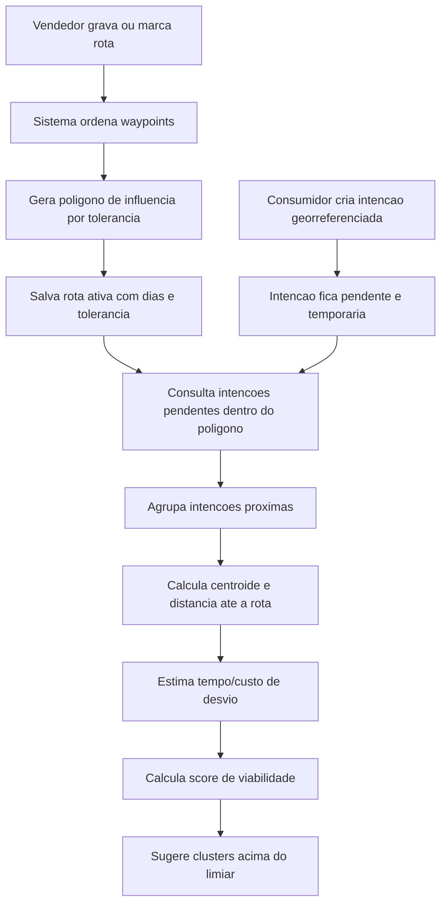

# Dossie tecnico de algoritmos - Ta Chegando

Data: 2026-05-30

Este documento organiza, em linguagem tecnica e de produto, os algoritmos e metodos computacionais do Ta Chegando que podem ser avaliados por advogado especializado em propriedade intelectual. Ele nao conclui patenteabilidade, nao substitui busca de anterioridade e nao redige reivindicacoes formais; serve como base tecnica para a estrategia juridica.

## Resumo executivo

O nucleo tecnico mais forte identificado no projeto e o **ERR - Expansor de Rotas de Requisicao**.

O ERR combina rota real ou planejada de vendedor itinerante, area geografica de influencia, intencoes de compra de consumidores, consulta espacial, agrupamento de demanda e pontuacao de viabilidade para sugerir ao vendedor oportunidades proximas da rota sem descaracterizar seu trajeto original.

Em termos simples: o sistema nao apenas mostra vendedores proximos nem apenas mostra um heatmap generico. Ele parte da rota de trabalho do vendedor e calcula quais demandas de consumidores sao tecnicamente viaveis de atender com baixo desvio.

## Algoritmos separados

### A1. ERR - Expansor de Rotas de Requisicao

**Prioridade para advogado:** alta.

**Problema resolvido:** vendedores ambulantes e itinerantes normalmente seguem trajetos praticos, repetitivos ou oportunisticos. Consumidores querem ser avisados quando o vendedor se aproxima, mas uma solicitacao individual pode nao justificar um desvio. O ERR transforma multiplas intencoes de consumidores em pontos de demanda viaveis perto da rota do vendedor.

**Entrada tecnica:**

- Identificador do vendedor.
- Lista ordenada de pontos da rota, composta por latitude, longitude e ordem.
- Dias ativos da rota.
- Tolerancia maxima de desvio em metros.
- Intencoes de compra pendentes, com localizacao geografica do consumidor.

**Processamento:**

1. Valida se a rota possui pontos e dias ativos.
2. Gera uma area de influencia ao redor da linha da rota usando a tolerancia configurada.
3. Persiste a rota ativa com pontos, dias, tolerancia e poligono de influencia.
4. Busca intencoes de compra pendentes dentro do poligono de influencia.
5. Agrupa intencoes proximas em clusters de demanda.
6. Calcula centroide do cluster.
7. Calcula distancia perpendicular do cluster em relacao a rota.
8. Estima tempo de desvio.
9. Calcula uma pontuacao de viabilidade que pondera volume de consumidores e custo de desvio.
10. Filtra os clusters abaixo do limiar minimo de viabilidade.

**Saida tecnica:**

- Lista de clusters de demanda sugeridos.
- Centroide de cada cluster.
- Quantidade de intencoes no cluster.
- Distancia perpendicular em metros.
- Tempo estimado de desvio.
- Pontuacao de viabilidade.

**Diferencial tecnico a destacar:**

O metodo usa a rota do vendedor como restricao primaria, nao apenas a distancia entre vendedor e consumidor em tempo real. A decisao passa a considerar uma area dinamica gerada a partir do trajeto e um score de custo-beneficio entre demanda agregada e desvio operacional.

**Evidencias no codigo:**

- `KotlinProject/composeApp/src/commonMain/kotlin/org/example/project/features/vendor/err/ERREngine.kt`: inicializa rota, gera poligono, salva rota e processa intencoes.
- `KotlinProject/composeApp/src/commonMain/kotlin/org/example/project/core/utils/ClusterEngine.kt`: gera clusters, centroide, distancia perpendicular, tempo de desvio e score de viabilidade.
- `KotlinProject/composeApp/src/commonMain/kotlin/org/example/project/core/domain/models/RouteModel.kt`: define `VendorRoute`, `ERRConfig`, `DemandCluster` e `PurchaseIntent`.
- `supabase/migrations/20260506132000_live_err_backend.sql`: cria tabelas, indices espaciais e RPCs `create_route_buffer` e `get_intents_in_polygon`.

### A2. Captura inteligente de rota operacional

**Prioridade para advogado:** media, como parte dependente do ERR.

**Problema resolvido:** uma rota gravada por GPS pode gerar ruido e pontos excessivos. O sistema precisa transformar deslocamento real em pontos de rota minimamente uteis.

**Entrada tecnica:**

- Coordenadas de localizacao recebidas durante a gravacao.
- Estado de gravacao.
- Modo de criacao: gravacao por GPS ou marcacao manual.

**Processamento:**

1. Inicia uma rota vazia em modo de gravacao.
2. Registra o primeiro ponto, se existir localizacao inicial.
3. Ignora atualizacoes que estejam a menos de 10 metros do ultimo ponto gravado.
4. Mantem a ordem dos pontos.
5. Permite fechar ciclo quando a rota tem pontos suficientes.
6. Permite criacao manual ponto a ponto como alternativa ao GPS.

**Saida tecnica:**

- Lista ordenada de waypoints normalizados.
- Estado da rota: gravando, revisavel, iniciavel ou fechada.

**Evidencias no codigo:**

- `KotlinProject/composeApp/src/commonMain/kotlin/org/example/project/features/vendor/err/RouteDraftState.kt`: controla gravacao, filtro minimo de distancia, reindexacao e fechamento de ciclo.
- `KotlinProject/composeApp/src/commonMain/kotlin/org/example/project/core/utils/GeoUtils.kt`: calcula distancia geodesica entre pontos.

### A3. Alerta de chegada baseado em intencao de compra georreferenciada

**Prioridade para advogado:** media, melhor como modulo do ERR.

**Problema resolvido:** o consumidor nao apenas favorita um vendedor; ele registra uma intencao de ser avisado em uma localizacao especifica. Essa intencao vira sinal computacional de demanda para a rota.

**Entrada tecnica:**

- Consumidor autenticado.
- Vendedor selecionado.
- Localizacao do consumidor ou ponto de interesse.

**Processamento:**

1. Valida consumidor autenticado.
2. Cria uma intencao pendente associada a vendedor e localizacao.
3. Armazena a localizacao como ponto geografico.
4. Mantem ciclo de vida por status e expiracao.
5. Disponibiliza a intencao para consulta espacial pelo ERR.

**Saida tecnica:**

- Registro de intencao de compra pendente, georreferenciado e temporario.

**Evidencias no codigo:**

- `KotlinProject/composeApp/src/commonMain/kotlin/org/example/project/core/data/PurchaseIntentRepository.kt`: cria alerta/intencao com `POINT(longitude latitude)`.
- `supabase/migrations/20260506132000_live_err_backend.sql`: tabela `purchase_intents`, status, expiracao e indice espacial.

### A4. Agregacao de demanda e heatmap operacional

**Prioridade para advogado:** media-baixa no estado atual; alta apenas se for combinado ao ERR.

**Problema resolvido:** vendedor precisa ver onde ha mais clientes procurando produtos. Isoladamente, heatmap e comum. O diferencial aparece quando o heatmap e derivado de intencoes, rota e viabilidade de desvio.

**Estado atual:** ha tela de heatmap com zonas simuladas, e ha estrutura real de clusters de demanda no backend. O argumento tecnico mais forte nao e "mostrar manchas no mapa", mas sim "gerar zonas de calor a partir de intencoes de compra filtradas por rota e pontuadas por viabilidade".

**Evidencias no codigo:**

- `KotlinProject/composeApp/src/commonMain/kotlin/org/example/project/features/vendor/HeatmapScreen.kt`: interface de heatmap.
- `supabase/migrations/20260506132000_live_err_backend.sql`: tabela `demand_clusters` com centroide, volume, distancia, desvio e score.
- `KotlinProject/composeApp/src/commonMain/kotlin/org/example/project/core/ui/maps/NativeMap.kt`: contrato comum para renderizar `heatZones`.

### A5. ETA e acompanhamento de vendedor

**Prioridade para advogado:** baixa no estado atual, salvo se integrado ao ERR.

**Problema resolvido:** consumidor acompanha vendedor e recebe expectativa de chegada. No codigo atual, a tela exibe acompanhamento em tempo real do vendedor, mas o texto de ETA ainda esta fixo.

**Como pode virar variacao tecnica:** estimar chegada com base em rota ativa, posicao do vendedor, velocidade observada, distancia ate o ponto de intencao e restricoes de desvio do ERR.

**Evidencias no codigo:**

- `KotlinProject/composeApp/src/commonMain/kotlin/org/example/project/features/consumer/VendorTrackingScreen.kt`: tela de acompanhamento e mapa com localizacao do vendedor.
- `KotlinProject/composeApp/src/commonMain/kotlin/org/example/project/core/data/VendorRepository.kt`: atualizacao e escuta em tempo real da localizacao do vendedor.

### A6. Orquestracao de frota por demanda e rota

**Prioridade para advogado:** conceitual no estado atual.

**Problema resolvido:** quando ha varios vendedores ou veiculos, o sistema poderia distribuir rotas e oportunidades considerando cobertura geografica, demanda agregada e capacidade operacional.

**Estado atual:** ha historias de produto sobre frota e gestao consolidada, mas a implementacao de algoritmo de atribuicao de frota ainda nao aparece como nucleo tecnico fechado no codigo analisado.

**Como pode virar variacao tecnica:** selecionar qual vendedor de uma frota deve atender um cluster de demanda considerando rota ativa, distancia perpendicular, score de viabilidade, horario, categoria do produto e carga operacional.

## Tese tecnica principal para o advogado

O ponto de maior valor inventivo nao e um mapa, uma notificacao ou uma rota isoladamente. A tese tecnica deve ser:

> Um metodo computacional para expandir rotas operacionais de vendedores itinerantes a partir de intencoes de compra georreferenciadas, gerando uma zona de influencia dinamica da rota, filtrando intencoes pendentes dentro dessa zona, agrupando demanda proxima, estimando custo de desvio e produzindo uma pontuacao de viabilidade para sugerir oportunidades de atendimento sem descaracterizar o trajeto original.

## Possiveis reivindicacoes tecnicas para o advogado avaliar

Estas frases nao sao reivindicacoes juridicas finais. Sao insumos tecnicos para o advogado adaptar.

1. Metodo para receber uma rota ordenada de um vendedor itinerante e gerar uma area geografica de influencia por tolerancia de desvio configuravel.
2. Metodo para receber intencoes de compra georreferenciadas e temporarias de consumidores e filtra-las por intersecao com a area de influencia de uma rota ativa.
3. Metodo para agrupar intencoes de compra proximas em clusters de demanda associados a uma rota.
4. Metodo para calcular centroide, distancia perpendicular em relacao a rota, estimativa de tempo de desvio e pontuacao de viabilidade de atendimento.
5. Metodo para sugerir ao vendedor clusters de demanda somente quando a pontuacao excede limiar minimo configuravel.
6. Sistema que combina captura de rota por GPS, poligono espacial, intencao de compra, agrupamento de demanda e ranking de oportunidade.
7. Variacao em que a pontuacao inclui categoria de produto, horario, frequencia historica, velocidade do vendedor, capacidade de atendimento ou regras de frota.
8. Variacao em que o consumidor recebe alerta de chegada quando a rota ativa ou uma expansao aprovada entra em raio configuravel do ponto de intencao.

## Fluxo tecnico consolidado

## Estado de maturidade tecnica

### Ja implementado ou representado no codigo

- Modelo de rota, waypoint, configuracao, intencao e cluster.
- Captura de rota por GPS ou marcacao manual.
- Filtro minimo de 10 metros entre pontos gravados.
- Geracao de poligono de influencia via PostGIS `ST_Buffer`.
- Persistencia de rotas com tolerancia e dias ativos.
- Criacao de intencao de compra georreferenciada.
- Consulta espacial de intencoes dentro de poligono.
- Estrutura de cluster com centroide, volume, distancia, desvio e score.
- Indices espaciais para rotas, intencoes, vendedores e clusters.

### Parcial, demonstrativo ou a fortalecer antes de uma demonstracao tecnica

- O agrupamento atual simula DBSCAN por truncamento de latitude/longitude; para demonstracao forte, substituir por DBSCAN real, grade H3/geohash ou clustering espacial no banco.
- A distancia perpendicular atual considera a linha entre primeiro e ultimo ponto da rota; para maior rigor, calcular distancia minima ate todos os segmentos da rota.
- O heatmap visual esta com dados simulados; deve ser derivado de `demand_clusters` ou de intencoes reais.
- O ETA exibido ao consumidor ainda nao e calculado dinamicamente.
- A logica de expiracao, aceite, atendimento e conclusao das intencoes existe no schema, mas pode ser mais explorada no app.
- A orquestracao de frota ainda aparece como roadmap, nao como algoritmo implementado.

## Mapa de evidencias tecnicas

Use esta secao para localizar rapidamente onde cada parte da tese aparece no repositorio.

| Evidencia | Arquivo | Linhas |
| --- | --- | --- |
| Inicializacao do ERR, validacao de rota/dias, geracao de poligono e persistencia | `KotlinProject/composeApp/src/commonMain/kotlin/org/example/project/features/vendor/err/ERREngine.kt` | 16-40 |
| Busca de intencoes dentro da area de influencia e envio para clustering | `KotlinProject/composeApp/src/commonMain/kotlin/org/example/project/features/vendor/err/ERREngine.kt` | 48-51 |
| Agrupamento de intencoes por proximidade, centroide, distancia, desvio e score | `KotlinProject/composeApp/src/commonMain/kotlin/org/example/project/core/utils/ClusterEngine.kt` | 7-47 |
| Formula do score de viabilidade | `KotlinProject/composeApp/src/commonMain/kotlin/org/example/project/core/utils/ClusterEngine.kt` | 50-53 |
| Modelo de rota, tolerancia, config, cluster e intencao | `KotlinProject/composeApp/src/commonMain/kotlin/org/example/project/core/domain/models/RouteModel.kt` | 6-72 |
| Captura de rota por GPS, filtro minimo de 10 metros e waypoints ordenados | `KotlinProject/composeApp/src/commonMain/kotlin/org/example/project/features/vendor/err/RouteDraftState.kt` | 60-75, 103-125 |
| Distancia entre pontos e distancia perpendicular aproximada | `KotlinProject/composeApp/src/commonMain/kotlin/org/example/project/core/utils/GeoUtils.kt` | 12-33 |
| Chamada ao RPC de buffer espacial e fallback de poligono | `KotlinProject/composeApp/src/commonMain/kotlin/org/example/project/core/data/RouteRepository.kt` | 44-70 |
| Persistencia de rota com waypoints, tolerancia, poligono e dias ativos | `KotlinProject/composeApp/src/commonMain/kotlin/org/example/project/core/data/RouteRepository.kt` | 72-94 |
| Consulta de intencoes dentro do poligono | `KotlinProject/composeApp/src/commonMain/kotlin/org/example/project/core/data/RouteRepository.kt` | 101-119 |
| Criacao de alerta/intencao de compra georreferenciada | `KotlinProject/composeApp/src/commonMain/kotlin/org/example/project/core/data/PurchaseIntentRepository.kt` | 19-34 |
| Tabelas `vendor_routes`, `purchase_intents` e `demand_clusters` | `supabase/migrations/20260506132000_live_err_backend.sql` | 89-128 |
| Indices espaciais para localizacao, intencoes, clusters e rotas | `supabase/migrations/20260506132000_live_err_backend.sql` | 130-136 |
| RPC `get_intents_in_polygon` | `supabase/migrations/20260506132000_live_err_backend.sql` | 217-252 |
| RPC `create_route_buffer` com `ST_Buffer` | `supabase/migrations/20260506132000_live_err_backend.sql` | 255-278 |

## Melhorias tecnicas recomendadas antes de apresentar uma demo tecnica

Estas melhorias nao sao obrigatorias para preparar o advogado, mas aumentam a forca tecnica do material se houver demonstracao ou deposito com exemplos mais concretos.

1. Substituir o cluster demonstrativo por algoritmo espacial formal.
2. Calcular distancia minima entre cluster e cada segmento da rota.
3. Adicionar decaimento temporal no score, priorizando intencoes recentes.
4. Incluir compatibilidade de categoria/produto no score.
5. Persistir clusters calculados na tabela `demand_clusters`.
6. Gerar heatmap real a partir dos clusters persistidos.
7. Calcular ETA real no acompanhamento do consumidor.
8. Registrar eventos de aceite, rejeicao e conclusao de cluster para retroalimentar o score.

## Materiais de apoio para anexar ou mostrar ao advogado

### Codigo Kotlin

- `KotlinProject/composeApp/src/commonMain/kotlin/org/example/project/features/vendor/err/ERREngine.kt`
- `KotlinProject/composeApp/src/commonMain/kotlin/org/example/project/core/utils/ClusterEngine.kt`
- `KotlinProject/composeApp/src/commonMain/kotlin/org/example/project/features/vendor/err/RouteDraftState.kt`
- `KotlinProject/composeApp/src/commonMain/kotlin/org/example/project/core/domain/models/RouteModel.kt`
- `KotlinProject/composeApp/src/commonMain/kotlin/org/example/project/core/data/RouteRepository.kt`
- `KotlinProject/composeApp/src/commonMain/kotlin/org/example/project/core/data/PurchaseIntentRepository.kt`

### Banco de dados e funcoes espaciais

- `supabase/migrations/20260506132000_live_err_backend.sql`
- `supabase/migrations/0001_err_route_expansion.sql`
- `supabase/migrations/0002_err_rpc_direct.sql`

### Produto e roadmap

- `docs/STORIES.md`
- `README.md`

## Perguntas objetivas para o advogado

1. O melhor caminho e patente de metodo/sistema, registro de software, segredo industrial ou combinacao desses instrumentos?
2. A tese deve focar somente no ERR ou incluir alertas, heatmap e frota como variacoes dependentes?
3. E necessario fazer busca de anterioridade especifica em marketplace, delivery, roteirizacao, geofencing e mobile location services?
4. O deposito deve descrever exemplos de vendedor ambulante, frota e consumidor final como modalidades de uso?
5. Quais partes do algoritmo devem permanecer como segredo industrial em vez de aparecerem em detalhes no pedido?

## Conclusao tecnica

O material mais forte para protecao nao e "app que mostra vendedor perto". O ativo tecnico defensavel e o metodo de transformar rota de vendedor itinerante em uma area dinamica de atendimento, cruzar essa area com demanda georreferenciada e ranquear oportunidades por viabilidade operacional.

O ERR deve ser apresentado como invencao principal. Heatmap, alerta de chegada, ETA e frota devem entrar como modulos, aplicacoes ou variacoes da mesma arquitetura tecnica.
